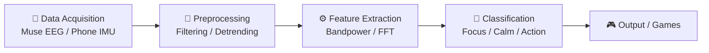

<div align="center">
  <h1>🧠 BCI & Kinematic Workshop: Muse EEG & Phone IMU</h1>
  <p>Real-time signal processing, visual telemetry, and BCI-controlled games designed for interactive workshops.</p>

  [](https://www.python.org/downloads/)
  [](https://github.com/astral-sh/uv)
  [](LICENSE)
</div>

This repository contains real-time signal processing, visual telemetry, and BCI-controlled games designed for interactive workshops. It bridges physiological signals (Muse S EEG) and kinematic motions (Phone/Watch IMUs) onto a unified dashboard to drive gameplay.

All scripts use the modern Python script metadata format and can be run instantly with `uv` (which automatically manages dependency environments).

---

## 🌊 Signal Processing Pipeline



---

## 🚀 Quickstart Environment Setup

Because this project relies heavily on real-time hardware (Bluetooth for the Muse headband, direct local network broadcasts for phone sensors, and OpenGL for 3D games), your installation path depends on your operating system.

### Option A: Native Setup (Recommended)
This is the fastest, lowest-friction way to run the workshop. Because the codebase uses `brainflow` (which handles native Bluetooth directly) and `uv` (which manages Python dependencies automatically), you can run this natively on Windows, macOS, or Linux without any virtual machines.

**Install Dependencies:**
Use [uv](https://github.com/astral-sh/uv), conda, or pip to manage your environment:
*   **uv**: `uv pip install -r requirements.txt` (Or let `uv run` handle it automatically!)
*   **conda**: `conda create -n bci python=3.12 && conda activate bci && pip install -r requirements.txt`
*   **pip**: `pip install -r requirements.txt`

**For Windows:**
Simply double-click the `install.bat` file in your File Explorer (or run it from Command Prompt). It will automatically download the required tools and sync the project dependencies.

**For macOS / Linux:**
Open a terminal in the project folder and run the installer script:
```bash
./install.sh
```

**Running the Dashboard:**
Once the installer finishes, you launch the entire workshop orchestrator with a single command:
```bash
uv run main.py
```
*(From this UI dashboard, you can launch the games and the Muse headset connectors with a single click—no further terminal commands needed!)*

### Option B: Virtual Machine Setup (Best for Windows/macOS)
**If your host is macOS or Windows, using a Linux Virtual Machine (VM) is the most reliable way to run this.** This allows you to securely pass through your USB Bluetooth adapter and 3D graphics hardware to a Linux environment.

**1. One-Click VM Setup (Vagrant)**
If you have [Vagrant](https://developer.hashicorp.com/vagrant) and VirtualBox installed, you can automatically spin up a fully configured Ubuntu desktop VM:
```bash
vagrant up
vagrant reload
```
*   When the VirtualBox window appears, login with username: `vagrant` and password: `vagrant`.
*   Run `startx` to launch the desktop environment.
*   *Important:* Use the VirtualBox top menu (`Devices > USB`) to attach your host's Bluetooth adapter to the VM.
*   Open a terminal, run `cd /app`, and launch the dashboard with `uv run main.py`.

**2. Manual VM Setup**
If you are provisioning your own VM (e.g., VMware, or manual VirtualBox):
1.  **Enable 3D Acceleration** in your VM's Display settings.
2.  **Pass through your Host's Bluetooth adapter** via USB settings.
3.  Run the included setup script inside the VM to install all necessary system packages:
    ```bash
    ./setup_vm.sh
    uv run main.py
    ```

### Option C: Docker (Best for Headless Linux / CI)
A `Dockerfile` and `docker-compose.yml` are provided. This setup uses host networking and X11 socket forwarding.
```bash
docker-compose up --build
```
*(Note: Docker on Mac/Windows runs inside a hidden VM, making X11 forwarding and Bluetooth passthrough extremely difficult. Option C is only recommended for Linux hosts).*

---

## 📚 Workshop Modules Breakdown

### 1. Master Control Dashboard (`main.py`)

The central nervous system of the project. This PyQt6 dashboard manages incoming LSL streams, computes real-time DSP metrics, and pipes control tokens to games.

To launch the dashboard:
```bash
uv run main.py
```

### Key Features:
*   **🔌 Auto-Connect**: Automatically binds to active LSL streams on the network.
*   **📊 Live EEG Spectrum**: Visualizes raw EEG waveforms, performs real-time bandpower FFT (Alpha/Beta/Gamma), and extracts focus/calm scores.
*   **📐 3D Kinematics**: Displays 3D rotation trajectories and computes real-time zero-baseline sensor calibration.
*   **📈 Controller Mapping & Tuning Oscilloscope**:
    *   Map signals to action tokens (`left`, `right`, `up`, `down`, `action`, `sec_action`, `tert_action`).
    *   Exposes 7 live threshold sliders (Blink, Clench, Focus, Calm, Phone Tilt, Phone Flick, Phone Shake).
    *   Displays a real-time calibration scope plotting waveforms alongside color-coded threshold lines for immediate visual tuning.

### 2. Phone IMU Bridge (`phone_imu_bridge.py`) 

Turn any smartphone into an LSL motion controller without installing an app.

1.  Start the bridge:
    ```bash
    uv run phone_imu_bridge.py
    ```
2.  Open the secure link on your phone (e.g., `https://<your-ip>:8000`).
3.  Hold the phone naturally and click **🎯 Zero Sensors** on the dashboard to calibrate. Your phone is now streaming tilt angles, flick forces, shakes, and screen taps directly to the LSL network!

### 3. BCI-Controlled Games

Our games are built using Pygame and feature a **Unified Input System** (`game_input.py`) that unifies standard keyboard/mouse controls with incoming BCI/IMU tokens from the dashboard.

**OpenGL Retro Fighter (`lsl_retro_airplane.py`)**
An arcade jet shooter featuring particle systems and synthesized retro audio:
```bash
uv run lsl_retro_airplane.py
```
*   **Phone Tilt**: Slides the ship continuously (Continuous Analog steering).
*   **Phone Tap**: Instantly fires primary lasers.
*   **Phone Shake**: Triggers dual-laser spread shots.
*   **Muse EEG Eye Blink**: Triggers the ultimate screen-clearing smart bomb.
*   **Keyboard Backup**: `A`/`D`/`W`/`S` (steer), `Space` (fire), `Shift` (spread), `Ctrl` (bomb).

**BCI Snake Game (`lsl_snake_game.py`)**
```bash
uv run lsl_snake_game.py
```
*   **Tilt / Keys**: Changes direction and launches the game.
*   **Blink**: Turn Left.
*   **Jaw Clench**: Turn Right.
*   **Simulator Hotkeys**: `B` (simulate blink), `C` (simulate clench).

> **Galaxy Watch app v1.2 and newer** ([galaxy_watch_lsl](https://github.com/JohnGF/galaxy_watch_lsl))
> send the new W2 packet format (keep-alive with the screen off, body location, clock sync).
> `smartwatch_lsl_bridge.py` reads both W2 and the older CSV packets on UDP port 5005: the first
> watch still appears as `Smartwatch_IMU` / `Smartwatch_PPG`, a second one as `Smartwatch_IMU_P2` /
> `Smartwatch_PPG_P2` (player 2). On the watch, set the PC's IP and press Start; nothing else changes.
> The full nautilus_bci bridge (per-location stream names, clock sync, BIDS recording) is not needed here.
> Note: this repo's `lsl_api.cfg` puts everything in LSL session `bci_workshop`, so tools started outside
> this folder (LabRecorder, nautilus_bci) will not see these streams unless they use the same SessionID.

### 4. Smartwatch PPG & IMU Simulators (No Hardware Required)

We provide interactive simulators that stream high-fidelity PPG (optical heart rate) and kinematic data over LSL:

*   **watch_ppg_streamer.py**: Models red/green PPG sensors with heart rate variability (HRV), respiratory sinus arrhythmia (RSA), and keyboard controls (`W`/`S` to adjust BPM).
*   **watch_ppg_viewer.py**: Connects to LSL, applies a bandpass filter, and performs FFT-based heart rate extraction.
*   **watch_imu_streamer.py**: Streams simulated smartwatch 6-axis IMU motions (circular, figure-8, shakes).
*   **watch_imu_viewer_3d.py**: Connects to the watch IMU LSL node and plots integrated 3D trajectories.

### 5. Muse S (Athena) Connection (Requires Hardware)

Launches the persistent BLE hardware session and pipes raw EEG (Ch. 1-4) and PPG Optics (Ch. 1-9) onto LSL nodes `Muse_Athena` and `Muse_Optics`.
```bash
uv run athena_streamer.py
```

---

## 🛠️ Project Structure

```mermaid
graph TD
    A[main.py: Dashboard] --> B[lsl_retro_airplane.py: Game]
    A --> C[lsl_snake_game.py: Game]
    D[phone_imu_bridge.py] -->|LSL Stream| A
    E[athena_streamer.py] -->|LSL Stream| A
    F[watch_ppg_streamer.py] -->|LSL Stream| A
    
    classDef main fill:#1e1b4b,stroke:#a5b4fc,stroke-width:2px;
    classDef streamer fill:#064e3b,stroke:#34d399,stroke-width:2px;
    classDef game fill:#7f1d1d,stroke:#fca5a5,stroke-width:2px;
    
    class A main;
    class D,E,F streamer;
    class B,C game;
```



*   `main.py`: PyQt6 Master Control Dashboard.
*   `game_input.py`: Unified keyboard, mouse, and BCI/stdin action-mapping system.
*   `phone_imu_bridge.py`: Local WebSocket server to pipe phone sensor values to LSL.
*   `lsl_retro_airplane.py`: OpenGL Arcade Shooter with continuous steer and particle events.
*   `lsl_snake_game.py`: BCI Snake game with rolling signal visualizers.
*   `athena_streamer.py`: Bluetooth driver for the Muse S headband.
*   `ppg_viewer.py` & `lsl_viewer.py`: PPG heart rate visualizer and generic multi-channel time-series plotter.
*   `tests/`: Comprehensive unit tests covering BCI signal processing helpers, data loading/cleaning pipelines, feature extraction, and validation logic.

---

## 🔧 Troubleshooting

*   **VirtualBox 7.x 3D Acceleration:** Modern VirtualBox versions require the Graphics Controller to be set to `VMSVGA` in order to use 3D hardware acceleration. Our Vagrantfile automatically configures this, but keep it in mind if setting up manually.
*   **Software OpenGL Fallback (LLVMpipe):** If you are on an older laptop or a restricted corporate machine and the VirtualBox GPU passthrough causes a crash/lockup, you can force the application to run via CPU software rasterization by prepending the `LIBGL_ALWAYS_SOFTWARE` flag:
    ```bash
    LIBGL_ALWAYS_SOFTWARE=1 uv run main.py
    ```
*   **Vagrant Timeout / Windows Hyper-V Conflict:** If `vagrant up` times out waiting for SSH, and you are on Windows, this is usually caused by a conflict with **Hyper-V** (which is enabled by Docker Desktop and WSL2). Hyper-V causes VirtualBox VMs to run incredibly slowly or freeze on a black screen. **Solution:** Run the project natively on Windows using `uv run main.py` instead of using a VM.
*   **Ubuntu VM Freezing on Boot:** If your VM freezes with a `watchdog: BUG: soft lockup - CPU#0 stuck` error, ensure you have IOAPIC and Hardware Virtualization extensions enabled in your VM CPU settings.
*   **No Audio Device Found:** If you run the games inside a Docker container or a VM without sound configured, you will see a warning in the console: `Warning: Audio device not found`. The games have a graceful fallback mechanism and will simply run muted rather than crashing.
*   **X11 Forwarding on Windows (VcXsrv/Xming):** If you attempt to use Docker's X11 forwarding on a Windows host using VcXsrv, you **must** check the "Disable access control" box when launching XLaunch. Otherwise, the container will be denied permission to draw windows on your screen.
